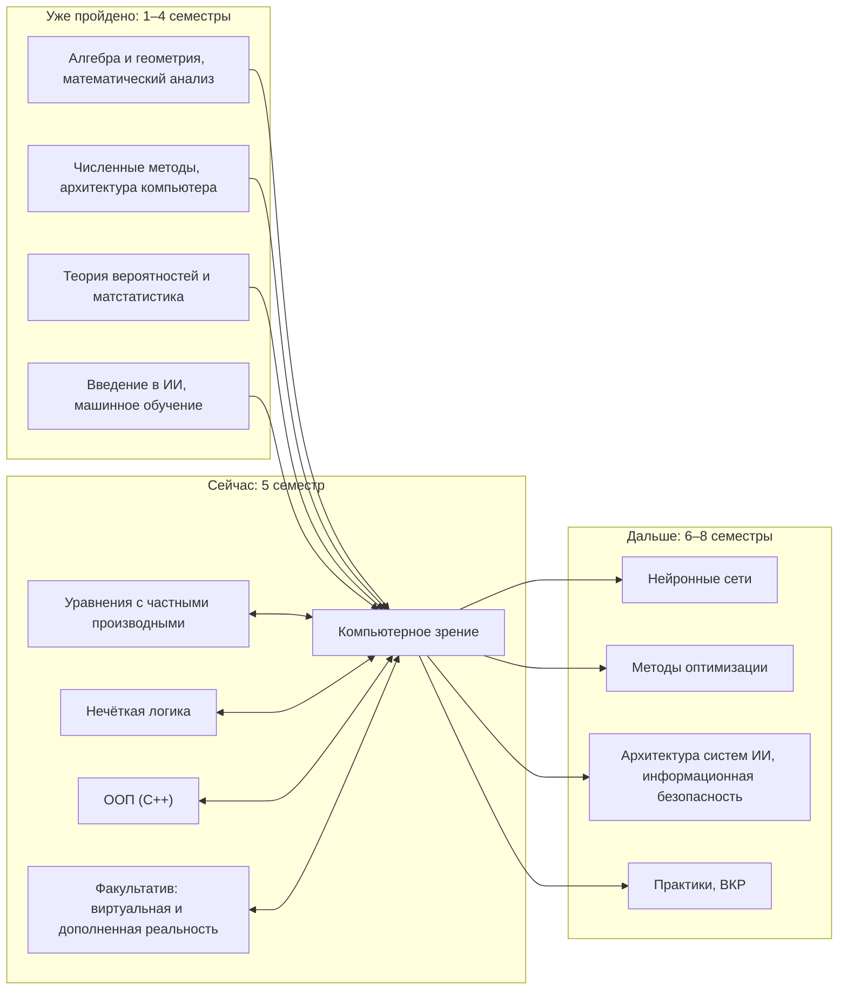

> **Первое занятие:** сначала [короткая инструкция](docs/ПЕРВЫЙ_СТАРТ.md). Если среда не работает — `00. Старт без установки.ipynb` или [HTML без Jupyter](docs/СТАРТ_БЕЗ_УСТАНОВКИ.html). GitHub необязателен; можно работать и сдавать файлами.

# Компьютерное зрение

Практические занятия по дисциплине «Компьютерное зрение» для направления 01.03.02 «Прикладная математика и информатика», профиль «Искусственный интеллект», СГУ им. Питирима Сорокина. 5 семестр.

Курс о том, как из таблицы чисел, которой для компьютера является любая картинка, извлечь смысл: от пикселей, камер и фильтров через классические алгоритмы OpenCV к первой собственной нейросети. За семестр каждый студент делает проект на своей съёмке или согласованном разрешённом наборе. В следующем семестре пригодится опыт проекта; данные и задача могут измениться.

Автор — Дуркин Анатолий Альбертович, старший преподаватель: anatoliy.durkin@mail.ru, Telegram @AnatoDu, канал https://t.me/code_matan_ai

## С чего начать

1. Скачайте курс (Git clone или Download ZIP). Один раз скопируйте **project_template целиком** в личную папку с любым именем, вне клона курса. Готовый студенческий ZIP уже содержит этот шаблон.
2. В собственной папке откройте `workbooks/01.1 Как компьютер видит мир.ipynb`. Поддержка и учебные данные находятся внутри `course_support`; соседний репозиторий не нужен. Подробно — [первый старт](docs/ПЕРВЫЙ_СТАРТ.md).
3. Условия проекта — в [ПРОЕКТ.md](docs/ПРОЕКТ.md), критерии оценки — в [ОЦЕНИВАНИЕ.md](docs/ОЦЕНИВАНИЕ.md), как сдавать — в [СДАЧА.md](docs/СДАЧА.md), как снимать данные — в [ДАННЫЕ.md](docs/ДАННЫЕ.md).
4. Книги, фильмы, курсы и соревнования по темам курса — в [ПОЛЕЗНОЕ.md](docs/ПОЛЕЗНОЕ.md).
5. Установка дома — [УСТАНОВКА.md](docs/УСТАНОВКА.md).

## Занятия

Каждое занятие — две пары, на каждую пару своя тетрадь. Номер тетради `NN.M` читается так: занятие NN, пара M.

| № | Пара 1 | Пара 2 | Выдаётся |
|---|---|---|---|
| 1 | Как компьютер видит мир | Цвет, яркость и ваш проект | выбор трека |
| 2 | Камера. От света к пикселю | Калибровка камеры | ЛР1 |
| 3 | Свёртка и линейные фильтры | Шум, нелинейные фильтры и масштаб | — |
| 4 | Края и градиенты | Бинаризация, морфология и контуры | ЛР2 |
| 5 | Особые точки и дескрипторы | Сопоставление, гомография и «скан из фото» | — |
| 6 | Сегментация | Поиск и классификация изображений по содержанию | — |
| 7 | Видео: кадры, фон, движение | Трекинг и классические детекторы | ЛР3 |
| 8 | Разметка: инструменты и форматы | Метрики: IoU и mAP своими руками | ЛР4 |
| 9 | Аугментации и разбиение без утечек | Решение без нейросетей | ЛР5 |
| 10 | Перцептрон своими руками | Многослойная сеть в PyTorch | ЛР6 |
| 11 | Свёрточная сеть | Переобучение и данные проекта | — |
| 12 | Первая нейросеть на ваших данных | Защита проектов | защита |

Тетради появляются к своему занятию.

## Как курс связан с другими дисциплинами



## Что в репозитории

```
01.1 … 12.2 .ipynb      тетради занятий: NN — занятие, M — пара
course_support/        проверки, вспомогательные функции и учебные данные
docs/                  правила курса и шпаргалки
project_template/      заготовка репозитория для вашего проекта
```

## Второй блок

Готовы тетради 02.1 и 02.2; условия первой лабораторной — [ЛР1](docs/ЛР1.md). 02.1 работает без OpenCV; в 02.2 предусмотрен отдельный разбор ошибки на NumPy, а библиотечная калибровка остаётся самостоятельной частью работы в доступной среде. Новые файлы добавляйте по [инструкции обновления](docs/ПЕРВЫЙ_СТАРТ.md), сохраняя старые ответы.

## Третий блок

Готовы 03.1 и 03.2. Номера обозначают учебные блоки, а не календарные недели. Фильтрация и шумоподавление работают на CPU. В 03.1/03.2 выберите маршрут с OpenCV либо раздел «Самостоятельная работа без OpenCV» в конце тетради: он использует NumPy/Matplotlib и свои учебные массивы. Исполняйте только выбранный маршрут, без Run All всей тетради. Новых лабораторных и баллов в этом блоке нет. Добавьте новые тетради в workbooks и обновите course_support целиком, сохранив свои ответы и данные.

В тетрадях 02.x/03.x новые операции разбираются по отдельности перед составными примерами. Подробные версии уже выполненных тетрадей сохраняйте рядом со своими ответами, а не поверх них; задания и баллы не изменены. Порядок обновления — [Работа с материалами](docs/ПЕРВЫЙ_СТАРТ.md).

## Четвёртый блок

Готовы 04.1 и 04.2: от разности пикселей к Собелю, от порога к морфологии и измерению по эталону. **Весь основной путь работает на NumPy и Matplotlib без OpenCV**, сверху вниз. Готовые иллюстрации подписаны как демонстрации; собственные расчёты выполняются отдельно. Условия второй лабораторной — [ЛР2](docs/ЛР2.md), NumPy и OpenCV оцениваются по одним критериям.

## Показ примеров и самостоятельные задания

Обычные разделы тетради не требуют решения «Ваш ход». Если временно пропускаете упражнение, пропустите также его `check(...)` и продолжайте следующий обычный раздел. Проверка относится к вашему ответу; она не выполняет задание за вас. Задания могут использовать ответы предыдущих заданий. Не заменяйте свою уже заполненную тетрадь новой версией поверх ответов.
